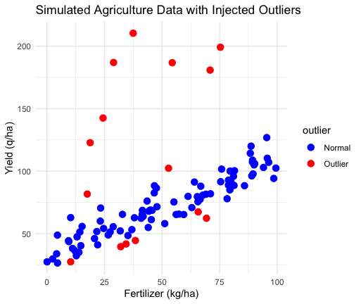

# Enhancing Robustness in Survey Estimation using the Huber Function

## About the Project

This research focuses on improving survey estimation in the presence of outliers using a generalized exponential estimator incorporating the Huber function.

## Methodology

The proposed estimator was compared with the traditional Ordinary Least Squares (OLS) estimator through theoretical MSE comparisons, analysis of education and agriculture data, and simulation studies with injected outliers.

## Analysis and Results

The study evaluates estimator performance using bias and Mean Squared Error (MSE). The plots below illustrate the outlier patterns and estimator comparisons across the datasets.

### 1. Agriculture MSE Comparison

### 2. Simulated Agriculture Data with Outliers

### 3. Education and Income with Outliers

### 4.  Education and Income MSE Comparison

## Tools Used

R, Python, Statistical Analysis, Robust Estimation

## Research Status

Research completed. Paper prepared and awaiting publication.

## Author

R Jayanth

